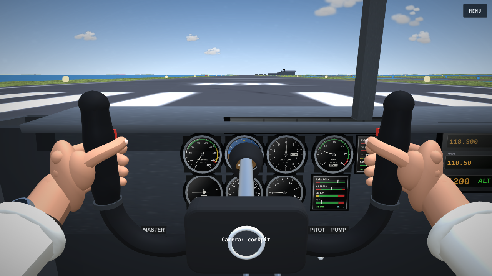

# Erika Air

A browser flight simulator built with three.js: streamed procedural terrain, real-world airfields, 6-DOF physics and interactive 3D cockpits.

**Play:** https://initfortehgames.github.io/erika-air/

Controls are listed in the game under the Controls tab. Press C to cycle cameras; in the cockpit, click switches and levers, scroll to zoom, double-click to recentre.

